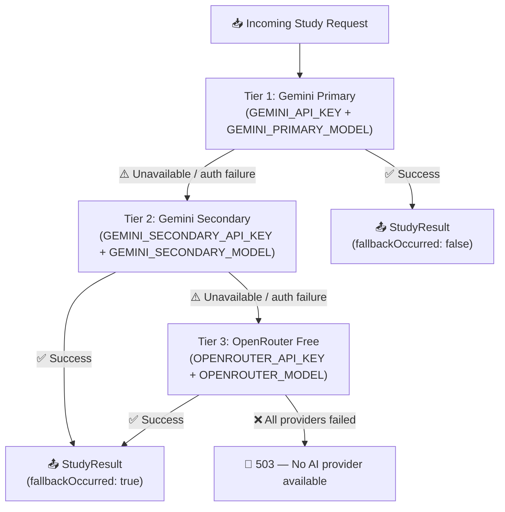

# AI Provider Fallback Architecture

Noctra uses a **3-tier sequential fallback** for all AI Study requests. If a higher-priority provider is unavailable or misconfigured, the engine automatically falls back to the next tier — without exposing the failure to the user beyond a `fallbackOccurred` flag in the response.

---

## Provider Order



---

## Provider Health Status Types

Each provider slot carries a runtime health status, tracked in [`src/lib/ai-provider-engine.ts`](../../src/lib/ai-provider-engine.ts):

| Status | Meaning |
|---|---|
| `configured` | Credentials present; provider is ready |
| `missing-credentials` | Required env var(s) are absent or empty; provider is skipped at startup |
| `authentication-failed` | Provider returned HTTP 401/403; API key is invalid or revoked |
| `temporarily-unavailable` | Provider returned HTTP 429 (rate limit) or 5xx; will retry after back-off |

Health status is updated after every request attempt and persisted in server memory for the lifetime of the Node.js process (reset on redeploy).

---

## Auth-Failure Short-Circuit

A subtle optimisation prevents wasted API calls when both Gemini tiers share the same API key:

> **If Tier 1 (Gemini Primary) fails with `authentication-failed` AND `GEMINI_SECONDARY_API_KEY` is not set (or equals `GEMINI_API_KEY`), Tier 2 is automatically skipped** — it would fail with the same error.

This behaviour is controlled by the `GEMINI_ALLOW_SHARED_KEY` environment variable:

| `GEMINI_ALLOW_SHARED_KEY` | Behaviour when keys match and Tier 1 auth fails |
|---|---|
| unset / `false` (default) | Tier 2 is **skipped**; falls through to OpenRouter |
| `true` | Tier 2 is **attempted** anyway (use only when intentionally testing fallback) |

---

## Environment Variables

| Variable | Required for | Description |
|---|---|---|
| `GEMINI_API_KEY` | Tier 1 | API key for the primary Gemini model |
| `GEMINI_PRIMARY_MODEL` | Tier 1 | Model ID, e.g. `gemini-3.5-flash` |
| `GEMINI_SECONDARY_API_KEY` | Tier 2 | Separate API key for the secondary Gemini model. If omitted, the auth-failure short-circuit applies. |
| `GEMINI_SECONDARY_MODEL` | Tier 2 | Model ID, e.g. `gemini-flash-lite-latest` |
| `OPENROUTER_API_KEY` | Tier 3 | API key for OpenRouter |
| `OPENROUTER_MODEL` | Tier 3 | Model ID, e.g. `nvidia/nemotron-3.5-lightning:free` |
| `GEMINI_ALLOW_SHARED_KEY` | Optional | Set `true` to allow Tier 2 when keys match |

All variables are **server-side only** — never prefixed with `NEXT_PUBLIC_`.

---

## Minimum Configuration

For a working AI Study feature you need **at least one** of:

```bash
# Option A — Gemini only (Tiers 1 + 2 with same key, falls through to skip Tier 2)
GEMINI_API_KEY=your-key
GEMINI_PRIMARY_MODEL=gemini-3.5-flash

# Option B — OpenRouter only (Tier 3)
OPENROUTER_API_KEY=your-key
OPENROUTER_MODEL=nvidia/nemotron-3.5-lightning:free

# Option C — Full 3-tier (recommended for production)
GEMINI_API_KEY=your-primary-key
GEMINI_PRIMARY_MODEL=gemini-3.5-flash
GEMINI_SECONDARY_API_KEY=your-secondary-key   # different key for true independence
GEMINI_SECONDARY_MODEL=gemini-flash-lite-latest
OPENROUTER_API_KEY=your-openrouter-key
OPENROUTER_MODEL=nvidia/nemotron-3.5-lightning:free
```

---

## Legacy OpenAI-Compatible Fallback

An additional optional fallback exists for any OpenAI-compatible API endpoint:

| Variable | Description |
|---|---|
| `NOCTRA_AI_BASE_URL` | Base URL of the OpenAI-compatible endpoint |
| `NOCTRA_AI_API_KEY` | API key for the endpoint |
| `NOCTRA_AI_MODEL` | Model ID |

This is not part of the standard 3-tier fallback; it is a separate escape hatch for self-hosted models.

---

## Related Documentation

- [AI Study Engine](./AI_STUDY_ENGINE.md)
- [Environment Variables](../development/ENVIRONMENT_VARIABLES.md)
