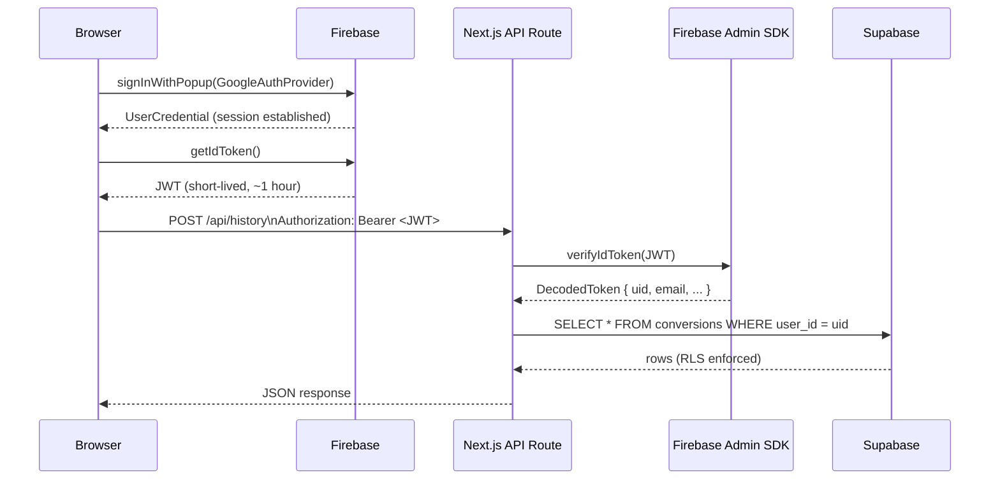

# Authentication Architecture

Noctra uses Firebase for authentication and Firebase Admin SDK for server-side token verification. Supabase is accessed exclusively with a service-role key from server routes — the browser never touches Supabase directly.

---

## Components

### Firebase Client SDK (Browser)

- Handles Google Sign-In via `signInWithPopup` / `signInWithRedirect`
- Manages the user session (token refresh, persistence)
- Provides `getIdToken()` to obtain a short-lived JWT for API calls
- Configured via `NEXT_PUBLIC_FIREBASE_*` environment variables (public identifiers — not secrets)

### Firebase Admin SDK (Server)

- Runs only in Next.js API routes (server-side)
- Calls `admin.auth().verifyIdToken(token)` to cryptographically validate the JWT
- The verified `uid` is the canonical user identifier used for all database operations
- Configured via `FIREBASE_ADMIN_PROJECT_ID` (required), `FIREBASE_ADMIN_CLIENT_EMAIL`, and `FIREBASE_ADMIN_PRIVATE_KEY` (optional; needed for admin operations beyond token verification)

> **Security invariant:** The server **never** trusts a `uid` or `userId` supplied in the request body. The UID is always read from the verified ID token. Any request body field named `uid` is ignored.

### Supabase (Server-Only)

- All Supabase operations happen in API routes using the `SUPABASE_SECRET_KEY` (or `SUPABASE_SERVICE_ROLE_KEY` for legacy projects)
- The browser calls `/api/history`, not Supabase directly
- Row-Level Security (RLS) policies enforce that users can only read/write rows where `user_id = auth.uid()`

---

## Session Flow

---

## AuthGuard

Client-side route protection is implemented in [`src/components/AuthGuard.tsx`](../../src/components/AuthGuard.tsx). It:

1. Subscribes to `onAuthStateChanged` from the Firebase client SDK.
2. Renders a loading state while auth state is resolving.
3. Redirects to `/` if the user is not signed in.
4. Renders children once auth is confirmed.

> **Note:** `AuthGuard` is a client-side protection layer for UX. The real security enforcement is done server-side via `verifyIdToken()` in API routes. An unauthenticated request to `/api/history` or `/api/study` is rejected with `401`, regardless of whether `AuthGuard` redirected the user.

---

## Token Refresh

Firebase ID tokens expire after 1 hour. The Firebase client SDK automatically refreshes them in the background. Before making an API call, the browser should always call `getIdToken(/* forceRefresh */ false)` — the SDK returns a cached token if it is still valid, or silently fetches a new one if it is near expiry.

---

## Environment Variables

| Variable | Side | Description |
|---|---|---|
| `NEXT_PUBLIC_FIREBASE_API_KEY` | Client | Firebase Web API key (public identifier) |
| `NEXT_PUBLIC_FIREBASE_AUTH_DOMAIN` | Client | Firebase Auth domain |
| `NEXT_PUBLIC_FIREBASE_PROJECT_ID` | Client | Firebase project ID |
| `NEXT_PUBLIC_FIREBASE_STORAGE_BUCKET` | Client | Firebase Storage bucket |
| `NEXT_PUBLIC_FIREBASE_MESSAGING_SENDER_ID` | Client | Firebase Messaging sender ID |
| `NEXT_PUBLIC_FIREBASE_APP_ID` | Client | Firebase App ID |
| `FIREBASE_ADMIN_PROJECT_ID` | Server | Must match the project that issued the tokens |
| `FIREBASE_ADMIN_CLIENT_EMAIL` | Server | Service account email (optional for verification-only) |
| `FIREBASE_ADMIN_PRIVATE_KEY` | Server | Service account private key (optional for verification-only) |

---

## Graceful Degradation

If the `NEXT_PUBLIC_FIREBASE_*` variables are missing or blank:

- The app still builds and the landing page renders.
- Google Sign-In is disabled.
- The dashboard shows a clear "Configuration required" banner instead of crashing.

---

## Related Documentation

- [Data Flow](./DATA_FLOW.md)
- [Security Model](../security/SECURITY_MODEL.md)
- [Environment Variables](../development/ENVIRONMENT_VARIABLES.md)
