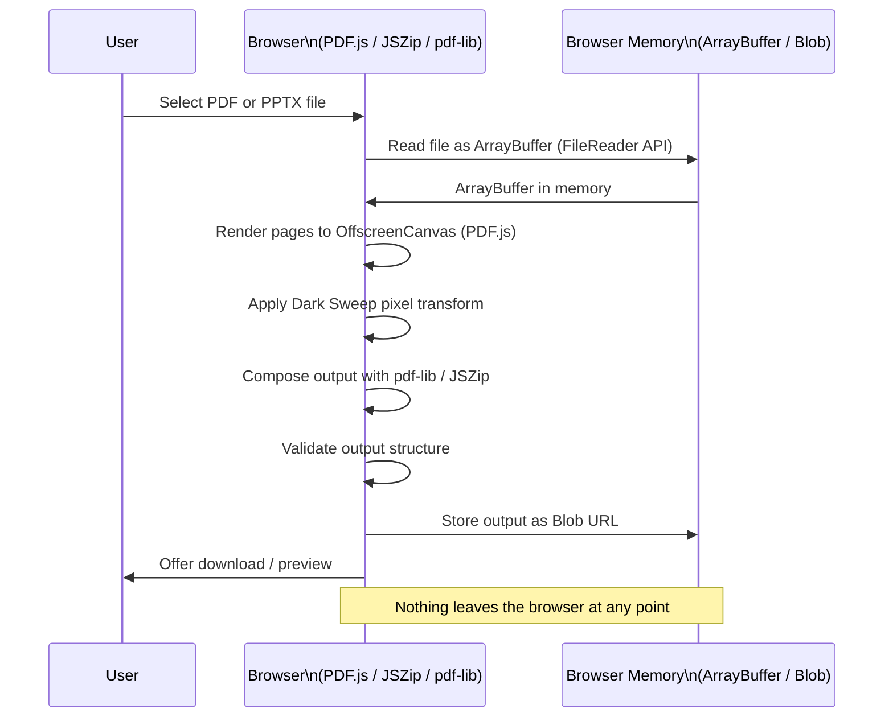
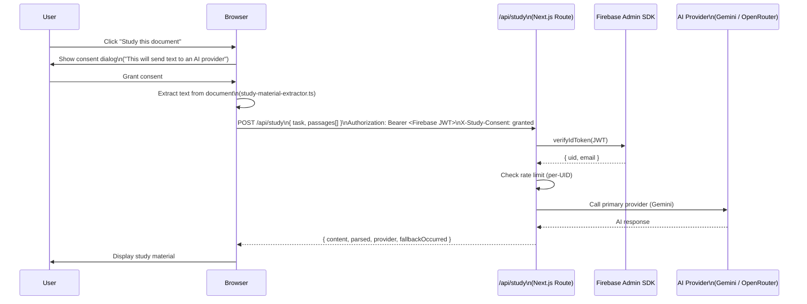
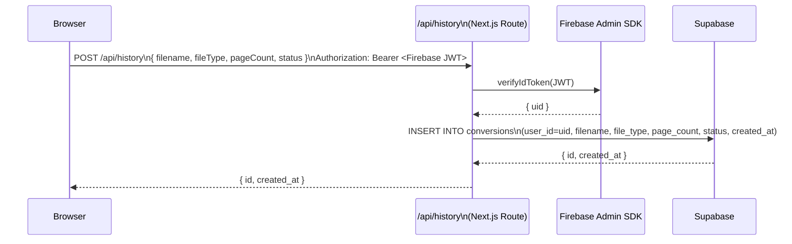

# Data Flow

This document traces the two primary data flows in Noctra: document conversion and AI study requests. Each flow has different privacy implications.

---

## Flow 1 — Document Conversion (Browser-Only)

This is the core privacy guarantee of Noctra. **Zero bytes of the user's document reach any server.**

---

## Flow 2 — AI Study (Server-Assisted, Consent Required)

**What is sent to the AI provider:**
- Extracted text passages from the document
- The task type (e.g., `quiz`, `flashcards`)
- Optional context string

**What is NOT sent:**
- The original file bytes
- Images or rendered page data
- The user's email or UID

---

## Flow 3 — Conversion History (Optional, Authenticated Only)

History storage is opt-in (available only to signed-in users) and stores **metadata only** — not file content.

**Data stored in Supabase (per conversion record):**

| Column | Example value | Notes |
|---|---|---|
| `user_id` | `firebase_uid_abc123` | From verified Firebase token |
| `filename` | `lecture-notes.pdf` | Original filename (user-controlled) |
| `file_type` | `pdf` | Input format |
| `page_count` | `42` | Extracted during conversion |
| `status` | `completed` | Lifecycle state |
| `created_at` | `2026-11-01T11:00:00Z` | Server timestamp |

**Not stored:** file bytes, rendered images, output PDFs, or extracted text.

---

## Data at Rest

| Data | Location | Retention |
|---|---|---|
| Converted file (output Blob) | Browser memory (Blob URL) | Until page unload or grace period expires |
| Conversion history metadata | Supabase | Until user deletes or requests account deletion |
| Firebase auth tokens | Firebase servers | Managed by Firebase; user can revoke via Google account |
| AI study responses | Not persisted | Returned in API response only; not stored |

---

## Related Documentation

- [System Overview](./SYSTEM_OVERVIEW.md)
- [Authentication](./AUTHENTICATION.md)
- [Privacy Architecture](../security/PRIVACY_ARCHITECTURE.md)
