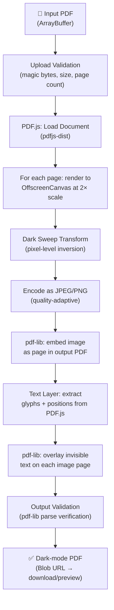
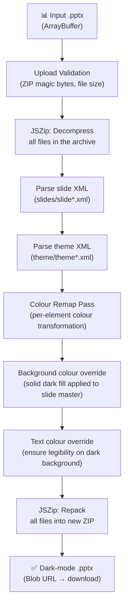

# Document Processing Pipeline

All document conversion in Noctra runs **entirely in the browser**. No file bytes are sent to any server at any point during conversion. This section describes the detailed pipeline for each supported input format.

---

## PDF Dark-Mode Conversion

**Input:** PDF file selected by the user  
**Output:** Dark-mode PDF with an invisible, copyable text layer  
**Key source files:**
- [`src/lib/pdf-converter.ts`](../../src/lib/pdf-converter.ts) — core engine
- [`src/lib/dark-transform.ts`](../../src/lib/dark-transform.ts) — pixel-level colour inversion
- [`src/lib/pdf-text-layer.ts`](../../src/lib/pdf-text-layer.ts) — text overlay composition

### Pipeline Stages

### Dark Sweep Algorithm

The core pixel transformation inverts luminance while preserving hue saturation, achieving a natural dark-mode appearance rather than a simple colour invert:

1. For each pixel `(r, g, b)` in the rendered page canvas:
   - Convert RGB → HSL
   - Invert lightness: `L′ = 1.0 - L`
   - Convert HSL → RGB
   - Write back to ImageData
2. Pixels below a configurable darkness threshold are clamped to `rgb(18, 18, 18)` to prevent near-black artefacts.
3. A white-balance correction is applied to pages that are predominantly white (typical documents).

### Invisible Text Layer

After assembling the image pages, Noctra overlays a transparent text layer sourced directly from the original PDF's glyph data (via PDF.js). This preserves:

- Text selection and copy-paste
- Screen-reader accessibility
- In-PDF search

The text layer does **not** consume additional file size in a material way — glyphs are positioned using `pdf-lib` transform matrices with `opacity: 0`.

### Output Validation

Before the output `Blob` URL is handed to the UI, `pdf-lib` re-parses the composed document to confirm:

- Valid PDF structure (correct cross-reference table)
- Expected page count matches input
- Embedded images are readable

A stall-watchdog with stage-scoped 30-second timeouts (`withStageTimeout()`) prevents conversion from hanging silently if any stage stalls.

---

## PPTX Dark-Mode Conversion

**Input:** `.pptx` file  
**Output:** Dark-mode `.pptx` with vector paths preserved  
**Key source files:**
- [`src/lib/pptx-converter.ts`](../../src/lib/pptx-converter.ts) — core engine

### Why PPTX is Vector-Preserving

Unlike PDF conversion (which rasterises pages to canvas), PPTX conversion operates directly on the XML internals of the file. Because `.pptx` files are ZIP archives of OOXML XML, the converter can recolour shapes, text, backgrounds, and fills at the XML attribute level — without rendering anything to a canvas. Vector paths, gradients (where supported), and font outlines survive unchanged.

### Pipeline Stages

### Colour Remap Logic

The remap pass walks the parsed XML DOM and processes the following OOXML colour types:

| OOXML attribute | Action |
|---|---|
| `<a:solidFill>` background fills | Replaced with dark palette colour |
| `<a:solidFill>` text runs on light background | Replaced with near-white |
| `<a:ln>` (line strokes) | Adjusted for visibility on dark background |
| `<a:gradFill>` gradient stops | Each stop remapped through the dark sweep function |
| Theme colour references (`<a:schemeClr>`) | Resolved to hex, then remapped |

> **Known limitation:** Complex gradient fills (radial gradients, multi-stop gradients with transparency) may not remap perfectly. The converter remaps what it can and leaves unsupported gradient types unchanged to avoid corruption.

### Supported Slide Elements

- Text boxes and placeholders
- Shapes with solid fills
- Slide backgrounds (master and layout)
- Tables (cell backgrounds and text)
- Charts (background fill)

---

## DOCX Support (Partial)

**Status:** ⚠️ Partial implementation  
**Source:** [`src/lib/docx-converter.ts`](../../src/lib/docx-converter.ts)

Text extraction from `.docx` files is implemented and used by the AI Study feature (extracting passages for study tasks). Full dark-mode DOCX → PDF conversion pipeline is **not yet implemented**.

---

## Conversion Profiles

Users can select conversion profiles (e.g., "high contrast", "sepia", "custom") that alter the dark sweep parameters:

- Foreground/background colour targets
- Contrast boost level
- Image gamma adjustment

Profiles are stored in browser local storage and applied client-side before the pixel transform step.

---

## Related Documentation

- [System Overview](./SYSTEM_OVERVIEW.md)
- [Data Flow](./DATA_FLOW.md)
