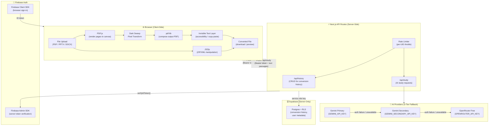

# Noctra — System Architecture Overview

Noctra is a **browser-first** document conversion and AI-powered study platform. Its central privacy guarantee is that document bytes never leave the user's machine during conversion — all rendering and transformation happens in the browser via WebAssembly and JavaScript.

---

## High-Level Architecture



---

## Privacy-First Model

| Operation | Where it runs | Data leaves the browser? |
|---|---|---|
| PDF dark-mode conversion | 100% browser | ❌ Never |
| PPTX dark-mode conversion | 100% browser | ❌ Never |
| File preview / thumbnail | 100% browser | ❌ Never |
| AI Study (summary, quiz, etc.) | Server (`/api/study`) | ✅ Only extracted text, with **explicit user consent** |
| Conversion history storage | Server (`/api/history`) | ✅ Metadata only (filename, page count, timestamp) — no file bytes |
| Authentication | Firebase (client + server) | ✅ Standard OAuth identity tokens |

---

## Key Technology Choices

| Concern | Technology | Rationale |
|---|---|---|
| PDF rendering | PDF.js (pdfjs-dist 6.x) | Gold-standard browser PDF renderer; WASM-accelerated |
| PDF output composition | pdf-lib | Pure JS; runs in browser with no server round-trip |
| PPTX manipulation | JSZip + XML parsing | PPTX is a ZIP of XML; vector paths preserved; no rasterisation |
| Authentication | Firebase Auth | Google-managed; no custom auth server needed |
| Server-side auth verification | Firebase Admin SDK | Cryptographically verifies ID tokens; never trusts client-supplied UIDs |
| History persistence | Supabase (Postgres + RLS) | Row-Level Security ensures users can only see their own history |
| AI study | Gemini + OpenRouter | 3-tier fallback ensures high availability without single-provider lock-in |
| Framework | Next.js 16.4.3 | App Router with React 19 Server Components and API routes |

---

## Component Map

```
src/
├── app/
│   ├── api/
│   │   ├── history/      — CRUD for conversion history (Firebase token verified)
│   │   ├── study/        — AI study endpoint (3-provider fallback)
│   │   └── reader/       — PDF reader API (WIP)
│   ├── dashboard/        — Authenticated dashboard (history, settings)
│   ├── study/            — AI study workspace
│   └── (landing)/        — Public landing page
├── components/
│   ├── ConversionEngine/ — PDF/PPTX conversion UI
│   ├── BatchUploadZone   — Multi-file batch conversion
│   └── AuthGuard         — Client-side route protection
└── lib/
    ├── pdf-converter.ts          — PDF dark sweep engine
    ├── pptx-converter.ts         — PPTX color remap engine
    ├── ai-provider-engine.ts     — 3-tier provider fallback logic
    ├── ai-study.ts               — Study task orchestration
    ├── supabase-config.ts        — Supabase client (server-only guard)
    └── validation.ts             — Input/output validation utilities
```

---

## Related Documentation

- [Document Processing Pipeline](./DOCUMENT_PROCESSING.md)
- [AI Study Engine](./AI_STUDY_ENGINE.md)
- [AI Provider Fallback](./AI_PROVIDER_FALLBACK.md)
- [Authentication](./AUTHENTICATION.md)
- [Data Flow](./DATA_FLOW.md)
